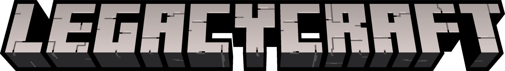

# LegacyCraft

LegacyCraft is an independent, clean-room Java/LWJGL recreation targeting the observable behaviour of Minecraft: Java Edition 1.8.9.

It is a work in progress. The current build includes a playable client, menus, saves, world generation, a dedicated server foundation, and an offline launcher. Some vanilla mechanics and compatibility features are still incomplete; see [`docs/compat/deviations.yml`](docs/compat/deviations.yml) for the current list.

LegacyCraft is not affiliated with or endorsed by Mojang or Microsoft.

## Prerequisites

- [JDK 17](https://adoptium.net/temurin/releases/?version=17) or newer
- [Git](https://git-scm.com/downloads)
- A graphics driver with OpenGL support
- A local copy of the Minecraft 1.8.9 resource files, if you want to run the client from source

The [Gradle Wrapper](https://docs.gradle.org/current/userguide/gradle_wrapper.html) supplies the required Gradle version, so Gradle does not need to be installed separately. [IntelliJ IDEA](https://www.jetbrains.com/idea/) is optional but recommended for development.

### Minecraft resource files

The repository intentionally does not redistribute Mojang's copyrighted textures, sounds, models, fonts, language files, or other vanilla assets. For local development, place resource files that you are legally entitled to use under:

```
src/main/resources/assets/minecraft/
```

That directory is ignored by Git. Do not commit it or include it in a pull request.

## Run from source

Clone the repository, add the local resource files described above, and run the client with the Gradle Wrapper.

Windows PowerShell:

```powershell
git clone https://github.com/AstricX9/LegacyCraft.git
cd LegacyCraft
.\gradlew.bat run
```

Linux or macOS:

```bash
git clone https://github.com/AstricX9/LegacyCraft.git
cd LegacyCraft
./gradlew run
```

Useful commands:

```text
run                 Launch the client
test                Run the test suite
generateGameData    Validate and generate the runtime block/item data
runServer           Start the headless dedicated server in run-server/
```

For example:

```powershell
.\gradlew.bat test
.\gradlew.bat run --args="--world=Test --debug"
```

The dedicated server uses offline mode and listens on port `25565` by default. Its settings and world are stored in `run-server/`.

## Build distributable packages

The build scripts create ready-to-copy packages containing the game, launcher, libraries, and platform start scripts:

```powershell
build.bat
```

```bash
./build.sh
```

You can also run a package task directly, for example `packageWindowsX64`, `packageLinuxX64`, `packageMacosArm64`, or `packageAll`. Output is written to `build/distributions/`.

Packaged builds need Java 17 on the target computer. A Java runtime can be placed in the package's `runtime/` directory; see [`packaging/windows/README.txt`](packaging/windows/README.txt) and [`packaging/unix/README.txt`](packaging/unix/README.txt).

## Project guide

- [`ARCHITECTURE.md`](ARCHITECTURE.md) — subsystem boundaries and implementation principles
- [`docs/compat/`](docs/compat/) — compatibility notes, deviations, verified facts, and source policy
- [`data/mc189/README.md`](data/mc189/README.md) — game-data authoring and generation
- [`launcher/`](launcher/) — the offline launcher
- [`packaging/`](packaging/) — platform packaging scripts and launch instructions

## License

LegacyCraft is licensed under the [GNU General Public License v3.0 or later](LICENSE).

## Contributing

Issues and pull requests are welcome. Please keep changes within the clean-room project scope, do not add proprietary Minecraft source or assets, and include tests for behaviour that can be verified automatically.
